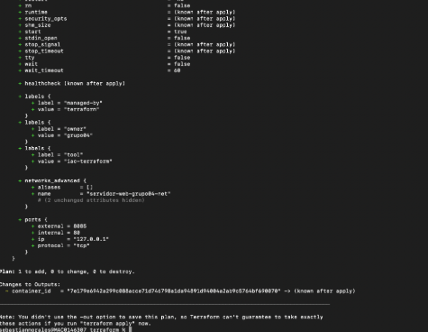
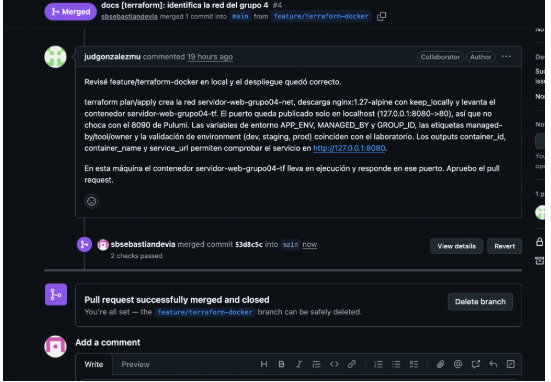
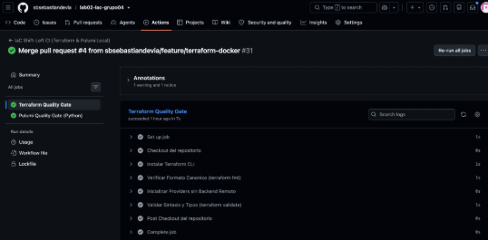
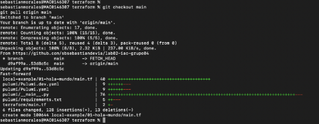
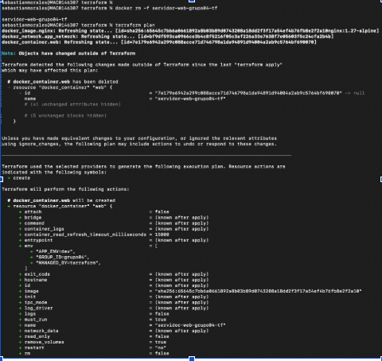
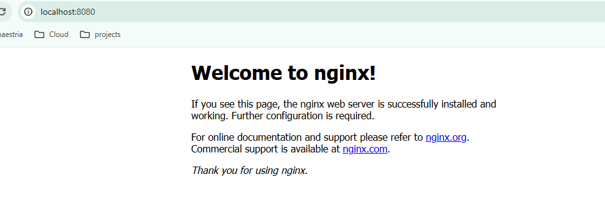
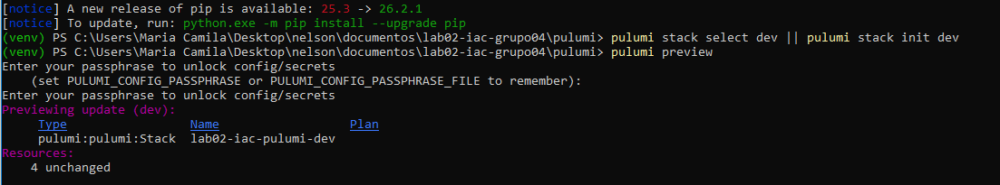
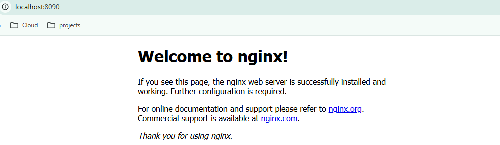
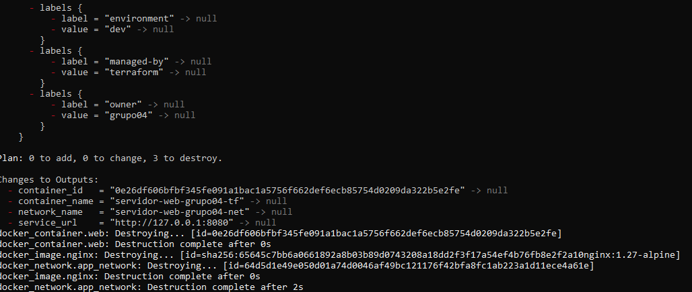
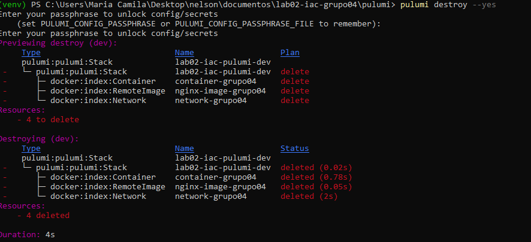

# Informe comparativo: Terraform vs. Pulumi

**Laboratorio 02 - IaC: Terraform vs. Pulumi | Fundamentos de DevOps y SRE**

## Equipo

**Grupo:** grupo04

**Integrantes:**

- **Nelson Fernando Ferrucho Gonzalez** - R1 (Terraform)
- **Juan David Gonzalez Munoz** - R2 (Pulumi)
- **Sebastian Morales Devia** - R3 (Platform Lead)

## Evidencias de la práctica

### Terraform (R1 + R3)

- `terraform init` y `terraform apply -auto-approve`: creación exitosa de 3 recursos (red, imagen Nginx y contenedor). Salida: `Apply complete! Resources: 3 added, 0 changed, 0 destroyed.`
- Contenedor `servidor-web-grupo04-tf` en ejecución y servicio Nginx accesible en `http://127.0.0.1:8085`.
- **Drift:** `docker rm -f servidor-web-grupo04-tf` -> `terraform plan` detecta el contenedor eliminado y planea recrearlo.

### Pulumi (R2 + R3)

- Stack `lab02-iac-pulumi-dev` con 3 recursos (red, imagen Nginx, contenedor `servidor-web-grupo04-pulumi`, puerto 8090).
- **Drift:** tras eliminar el contenedor, `pulumi preview --refresh` muestra `network-grupo04` y `nginx-image-grupo04` sin cambios (refresh), y `container-grupo04` marcado como `+ create`. Resultado: `+ 1 to create, 3 unchanged`.

### Pipeline CI (R3)

- Workflow `.github/workflows/iac-ci.yml` con dos quality gates (Terraform y Pulumi) que se ejecutan en cada Pull Request y push a `main`.

## Revisión cruzada

Cada participante descarga la rama de otro participante para realizar la rotación del experimento.

### Simulación de drift en Pulumi

### Merge

Se presenta la explicación; en Terraform se recrea el contenedor.

### Pipeline

### Git checkout

## Simulación de drift en Terraform

**Resultado de la ejecución de Terraform**

[Ver salida de aprobación de Terraform](./images/approve.txt)

**Previsualización de Pulumi**

**Nginx en Pulumi**

## Matriz de comparación empírica

| Criterio de comparación | Terraform (HCL) | Pulumi (Python) | Análisis del grupo con evidencia observada |
|---|---|---|---|
| **1. Curva de aprendizaje y sintaxis** | DSL declarativo especializado | Lenguaje general orientado a objetos | R1 configuró el contenedor más rápido: HCL es declarativo y directo, no exige saber programar. R2 necesitó manejar conceptos de Python (objetos, imports). Para quien ya programa en Python, Pulumi se sintió natural; para infraestructura pura, HCL fue más veloz de arrancar. |
| **2. Líneas de código efectivas (LOC)** | ~48 líneas (`main.tf`) | ~60 líneas (`__main__.py`) | Excluyendo comentarios y líneas en blanco, Terraform resultó más compacto para el mismo resultado. Pulumi agrega boilerplate de Python (imports, construcción de objetos Args, validación manual), lo que incrementa el conteo. |
| **3. Manejo del estado (State)** | Archivo `terraform.tfstate` local | Metadatos de Stack local en `~/.pulumi` | En Terraform el estado es un único archivo JSON (`terraform.tfstate`) fácil de abrir e inspeccionar. En Pulumi el estado vive en el backend (local `file://~`), consultable con `pulumi stack`. Terraform fue más transparente para ver a ojo qué recursos existen; Pulumi lo abstrae tras comandos. |
| **4. Validación de variables y tipos** | Bloque `validation { condition = ... }` | Lógica en Python (`if ... raise ValueError`) | Terraform valida declarativamente dentro de `variable` (ej. ambiente debe ser dev/staging/prod) y falla en `plan`/`apply` con mensaje claro. Pulumi valida con código Python (`if environment not in valid_envs: raise ValueError`), detectando el error al ejecutar. Ambos detectan temprano; Terraform da el mensaje más estandarizado. |
| **5. Detección y corrección de drift** | `terraform plan` | `pulumi preview --refresh` | Al borrar el contenedor manualmente con `docker rm -f`, ambas herramientas detectaron la deriva. **Terraform:** `terraform plan` reportó el contenedor eliminado y planeó recrearlo (`Plan: 1 to add`). **Pulumi:** `pulumi preview --refresh` mostró `network` e `image` intactos (unchanged) y `container-grupo04` como `+ create` (`+ 1 to create, 3 unchanged`). Las dos reconcilian el estado real contra el código. |
| **6. Multiplicidad y ciclos** | Meta-argumento `count` / `for_each` | Bucle estándar `for` en listas Python | Para crear N réplicas, Pulumi resultó más legible al usar un `for` nativo de Python (familiar para cualquier desarrollador). Terraform usa `count`/`for_each`, potentes pero con una sintaxis más específica del DSL que requiere aprenderse. |
| **7. Ecosistema de linters / Shift-Left** | `terraform fmt`, `terraform validate` | `ruff`, `flake8` | En el pipeline de CI (GitHub Actions), el gate de Terraform (`fmt -check` + `validate`) fue muy rápido y detectó de inmediato problemas de formato (de hecho, rechazó el primer push por formato no canónico). El gate de Pulumi (Ruff + Flake8) analiza el código Python. Ambos quality gates se ejecutan en paralelo en cada PR (enfoque Shift-Left). |

## Destrucción limpia verificada ($0 residuos)

### Terraform

`terraform destroy -auto-approve` elimina el contenedor y la red. Verificado con `docker ps` (sin `servidor-web-grupo04-tf`) y `docker network ls` (sin la red).

### Pulumi

`pulumi destroy --yes` elimina los recursos del stack. Se requiere una clave para realizar el proceso de destrucción en Pulumi.

> **Nota:** El enunciado usa `grupo01` como ejemplo; los nombres reales de este grupo son `servidor-web-grupo04-tf` (Terraform) y `servidor-web-grupo04-pulumi` (Pulumi).

## Conclusiones

- **Terraform** destacó por su concisión y transparencia del estado: menos líneas, estado en un archivo inspeccionable y un `fmt`/`validate` muy rápidos en CI. Ideal cuando el foco es puramente infraestructura declarativa.
- **Pulumi** destacó por aprovechar un lenguaje de propósito general (Python): la lógica (validaciones, bucles) se siente natural para quien ya programa, a costa de algo más de boilerplate.
- **Ambos detectan drift de forma efectiva:** al alterar la infraestructura por fuera del código, las dos herramientas reconciliaron el estado real contra el deseado y propusieron recrear el recurso eliminado, demostrando el valor central de la IaC.
- **Recomendación del grupo:** Terraform para equipos centrados en infraestructura y máxima legibilidad declarativa; Pulumi para equipos de desarrollo que prefieren reutilizar su conocimiento de un lenguaje de programación y necesitan lógica compleja.
